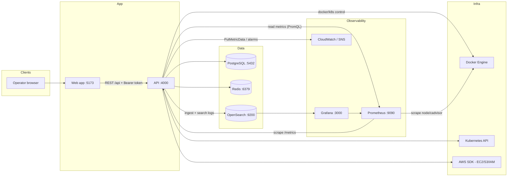
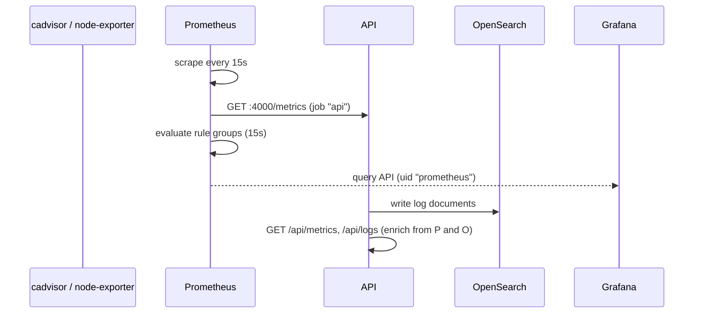

# CloudOps Hub Architecture

CloudOps Hub is an intelligent cloud operations platform: a TypeScript monorepo
that provides a single control plane for inventory, deployments, metrics, logs,
alerting, incident response, cost estimation and reporting across cloud and
container environments.

## High-level components

| Component | Technology | Port | Role |
| --- | --- | --- | --- |
| `apps/web` | Vite + React (TypeScript) | 5173 | Operator UI |
| `apps/api` | Express + Prisma (TypeScript) | 4000 | REST API, auth, RBAC, integrations |
| PostgreSQL 16 | `postgres:16-alpine` | 5432 | System of record (users, resources, alerts, incidents, ...) |
| Redis 7 | `redis:7-alpine` | 6379 | Cache / rate-limit counters (optional in dev) |
| Prometheus | `prom/prometheus:v2.48.0` | 9090 | Metrics scraping, recording and alert rules |
| Grafana | `grafana/grafana:10.2.2` | 3000 | Dashboards and visualization |
| OpenSearch | `opensearchproject/opensearch:2.11.0` | 9200 | Centralized log storage and search |

Supporting packages:

- `packages/config` - typed environment configuration shared by apps
- `packages/shared` - validation, pagination, error classes, health/crypto helpers
- `packages/types` - shared domain types and enums

Infrastructure:

- `docker/` - Dockerfiles for the API and the web app
- `infrastructure/prometheus` - scrape config and alert rules
- `infrastructure/grafana` - datasource/dashboard provisioning
- `infrastructure/opensearch` - single-node dev configuration
- `infrastructure/kubernetes` - plain Kubernetes manifests (namespace, configmaps, deployments, services, ingress)
- `infrastructure/terraform` - reusable modules + per-environment stacks
- `.github/workflows` - CI (lint, typecheck, test, build) and CD (images, Terraform, EC2)

## Data flow

Storage responsibilities:

- **PostgreSQL** is the source of truth for identity, RBAC, inventory
  (`Resource`), `Deployment`, `KubernetesCluster`/`KubernetesWorkload`, alert and
  incident state, cost estimates, reports and audit logs. Metric and log rows in
  the schema (`MetricSnapshot`, `LogEntry`) are metadata/indexes only.
- **Prometheus** stores time series (CPU, memory, disk, network, request and
  error rates) and evaluates the rules in
  `infrastructure/prometheus/alerts/cloudops-alerts.yml`.
- **OpenSearch** stores raw log documents in daily indices; retention is
  enforced by the ISM policy described in `docs/deployment.md`.
- **Redis** caches hot reads and rate-limit counters (optional in development).

## Request lifecycle

A typical authenticated API call:

1. **TLS/HTTP termination** - in Kubernetes the nginx ingress routes
   `cloudops.local/api` to service `api:4000`; in docker-compose the API is
   published directly on `:4000`.
2. **Security middleware** - `helmet`, CORS (`CORS_ORIGIN`), body parsing
   (10 MB limit), cookie parsing.
3. **Rate limiting** - `express-rate-limit` enforces
   `RATE_LIMIT_MAX_REQUESTS` per `RATE_LIMIT_WINDOW_MS`, returning
   `RATE_LIMIT_EXCEEDED` (429) with `standardHeaders`.
4. **Request ID** - `requestIdMiddleware` assigns/propagates `X-Request-ID`.
5. **Access logging** - `morgan` (`dev` format in development, `combined` in
   production), skipping `/health` and `/ready`.
6. **Audit logging** - `auditLogger` records mutating requests into `AuditLog`
   with redacted sensitive fields (`password`, `passwordHash`, ...).
7. **Routing** - `/api/*` is handled by `src/routes/index.ts`, which mounts the
   module routers (`auth`, `users`, `resources`, `deployments`, `containers`,
   `kubernetes`, `metrics`, `logs`, `alerts`, `incidents`, `costs`, `reports`,
   `cicd`, `aws`, `health`).
8. **Authentication** - `authMiddleware` verifies the JWT from
   `Authorization: Bearer <accessToken>` and attaches `req.user`.
9. **Authorization** - `requireRole('ADMIN' | 'ENGINEER')` gates mutating
   routes; role order is `ADMIN > ENGINEER > VIEWER`.
10. **Validation** - Zod schemas (in `packages/shared` and each module) parse
    body/query through `validateSchema`, raising `VALIDATION_ERROR` (400).
11. **Service layer** - controllers call services, services call Prisma or the
    integration clients (Prometheus, OpenSearch, Docker, Kubernetes, AWS).
12. **Response** - success is wrapped as
    `{"success": true, "data": ..., "message": "..."}`, errors are mapped by
    `errorHandler` to `{"success": false, "error": {"code", "message"}}`.
13. **Graceful shutdown** - `SIGTERM`/`SIGINT` disconnect Prisma before exit so
    container rollouts drain cleanly.

## Prometheus scrape and alert path

## Environments

| Environment | Runner | State | Notes |
| --- | --- | --- | --- |
| development | docker-compose / `npm run dev` | local volumes, local Terraform state | hot reload via `develop.watch` |
| staging | AWS (Terraform `environments/staging`) | S3 backend (optional) | one size up from dev |
| production | GitHub Actions -> GHCR + EC2 SSH | S3 backend, `production` environment gate | Terraform apply only from `deploy.yml` |
